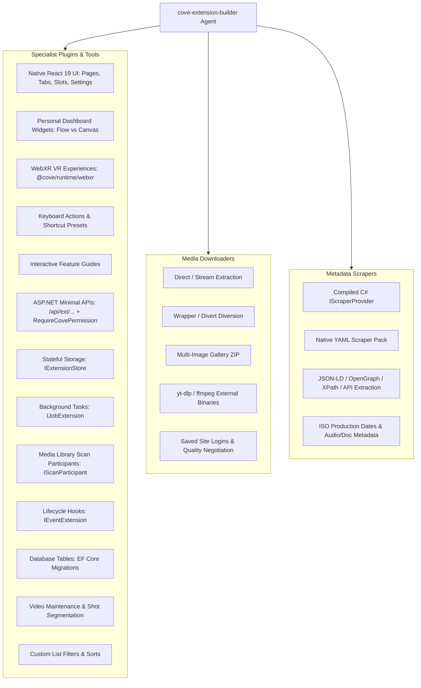

# cove-extension-builder

[](https://antigravity.google)
[](LICENSE)
[](https://yourcove.org)

Autonomous agent and specialized skill suite for designing, scaffolding, implementing, testing, and packaging extensions and plugins for [Cove](https://github.com/yourcove/cove).

Built against upstream `yourcove/cove` (`Cove.Sdk`, `Cove.Plugins`, and `Cove.Core` `v1.8.0`) contracts with full support for native desktop host environments (such as the native Windows desktop application).

---

## What This Suite Covers



---

## Agent & Skills Included

### 1. `cove-extension-builder` (Agent)
Location: `agents/cove-extension-builder.md`
Autonomous agent capable of end-to-end execution across all Cove extension types. Orchestrates reconnaissance, scaffolding, code authoring, offline fixture testing with `FakeDownloaderHost`, and verification packaging.

### 2. `cove-plugin-authoring` (Skill)
Location: `skills/cove-plugin-authoring/`
Specialist authoring skill for plugins that are **not downloaders or scrapers**:
- **Native UI Creation**: React 19 ESM bundles, `@cove/runtime/*` virtual module map, host component barrel (`@cove/runtime/components`), authenticated client (`@cove/runtime/api`), and Tailwind CSS v4 styling with host theme variables.
- **Personal Dashboard Widgets**: User-customizable dashboard widgets (`UIDashboardWidgetContribution`) rendering in Flow or Canvas layout contexts via `DashboardWidgetProps`.
- **WebXR VR Experiences**: Immersive headset/VR playback and session orchestration via `@cove/runtime/webxr`.
- **Keyboard Actions & Presets**: Configurable global key bindings via `AddKeyboardAction` and `AddKeyboardShortcutPreset`.
- **Interactive Feature Guides**: Built-in step-by-step extension walkthroughs via `featureGuides` manifests.
- **Backend API Surface**: Minimal APIs (`IApiExtension`) with authorization conventions (`RequireCovePermission`, `RequireCoveEntityAccess`, `AllowWithoutCovePermission`), tracked DI scopes (`IExtensionServiceScopeFactory`), stateful key-value storage (`IExtensionStore`), database entities & SQL migrations (`IDataExtension`), background jobs (`IJobExtension`), library scan participants (`IScanParticipant`), lifecycle events (`IEventExtension`), and action buttons (`IActionExtension`).
- **Official Cove Dev Docs Recall**: Systematic index mapping official developer guides (`overview.mdx`, `create-extension.mdx`, `extension-points.mdx`, `ui-extension-points.mdx`, `frontend-runtime.mdx`, `permissions.mdx`, `packaging.mdx`, `events.mdx`, `api/overview.mdx`, `local-development.mdx`) and upstream reference codebases (`cove-extensions-ui`, `AI.Extensions`, `recommendations`).

### 3. `cove-downloader-authoring` (Skill)
Location: `skills/cove-downloader-authoring/`
Authoring and testing compiled Cove downloaders (`IDownloaderProvider`):
- Direct video/image/audio streams, external diversion (`Divert = true`), multi-image gallery ZIPs, and external binary adaptors (`yt-dlp`/`ffmpeg`).
- Offline fixture testing with `FakeDownloaderHost`, progress reporting (`0.0` to `100.0`), quality negotiation (`DownloaderQualityOption`), and authenticated site logins (`IDownloaderSiteLoginProvider`).

### 4. `cove-scraper-authoring` (Skill)
Location: `skills/cove-scraper-authoring/`
Authoring compiled C# scrapers (`IScraperProvider`) and native YAML scraper packs (`kind: scraper-pack`):
- Structured metadata extraction from `application/ld+json`, OpenGraph tags, embedded JSON states, and XPath/DOM.
- Video, gallery, audio, and text document entity models with ISO production dates (`ProductionDate`) and host network permissions (`AllowNetworkHosts`).

---

## Static Rolling Releases & `latest-manifest.json` Feed

Cove installs extensions via `POST /api/extensions/install-from-url`, expecting a single `extension.json` per ZIP archive without tracking source URLs for updates.

To enable one-click updates and automated batch maintenance (e.g. via `ExtensionUpdater`) without replacing Cove's official registry, repositories configured with this suite publish **Static Rolling-Release URLs** and a **repo-wide `latest-manifest.json` feed** alongside normal versioned GitHub Releases:

- **Per-Extension Rolling Static ZIP**:
  ```
  https://github.com/<owner>/<repo>/releases/download/latest/<extensionId>-latest.zip
  ```
- **Repo-Wide Static Manifest Feed**:
  ```
  https://github.com/<owner>/<repo>/releases/download/latest/latest-manifest.json
  ```
- **Release Documentation**: [`docs/release-distribution-guide.md`](docs/release-distribution-guide.md)
- **Workflow Template**: [`templates/github-workflows/build.yml`](templates/github-workflows/build.yml)

The GitHub Actions release job ensures `latest` exists (`--latest=false`), downloads or initializes `latest-manifest.json`, extracts `extension.json` from each built package to update manifest records (`id`, `name`, `version`, `description`, `minCoveVersion`, `downloadUrl`, `versionedUrl`, `updatedAt`), copies packages to `<id>-latest.zip`, and uploads all assets to the `latest` release with `--clobber`.

---

## Upstream Cove API Sync & Verification

This suite includes automated tooling and comprehensive documentation to inspect upstream Cove releases, maintain API surface parity, and check contract baselines:

- **Automated Verification Tool**: [`scripts/sync-upstream-cove.py`](scripts/sync-upstream-cove.py)
  ```bash
  # Check upstream releases, tags, ABI baselines, and local reference parity
  python3 scripts/sync-upstream-cove.py
  ```
- **Sync & Maintenance Guide**: [`docs/upstream-sync-guide.md`](docs/upstream-sync-guide.md)
  A complete 5-phase procedure detailing Cove's versioning model (semver, ABI baseline with ApiCompat, `minCoveVersion`, unversioned `/api/` routes, frontend runtime `v1`), inspection techniques, and how to verify extension compatibility.

---

## Operating Environment & Host Architecture

Cove runs as a native desktop application (e.g. Windows native app desktop host):
- The backend runs as a local process with an embedded loopback API server.
- The UI is rendered within the desktop app's WebView via ESM modules (`dist/bundle.js` + `dist/bundle.css`).
- Storage (`IExtensionStore`) and data access are backed by the local workstation database and filesystems.
- Extensions package into `.zip` archives installed directly via **Settings › Extensions › Install from URL / File**.

---

## Installation & Upstream Sync

### Option 1: Add as a Git Submodule (Recommended for Extension Repos)

Inside your multi-extension repository (e.g. `kari-downloads`):

```bash
git submodule add https://github.com/otter-twunk/cove-extension-builder.git .agents/plugins/cove-extension-builder
```

To pull the latest updates from source at any time:

```bash
git submodule update --remote --merge .agents/plugins/cove-extension-builder
```

### Option 2: Clone Directly into `.agents/plugins/`

```bash
git clone https://github.com/otter-twunk/cove-extension-builder.git .agents/plugins/cove-extension-builder
```

To pull updates:

```bash
git -C .agents/plugins/cove-extension-builder pull --ff-only origin main
```

---

## License

[MIT](LICENSE) © 2026 otter-twunk
